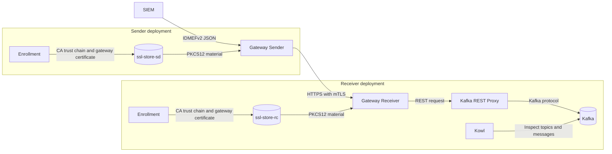
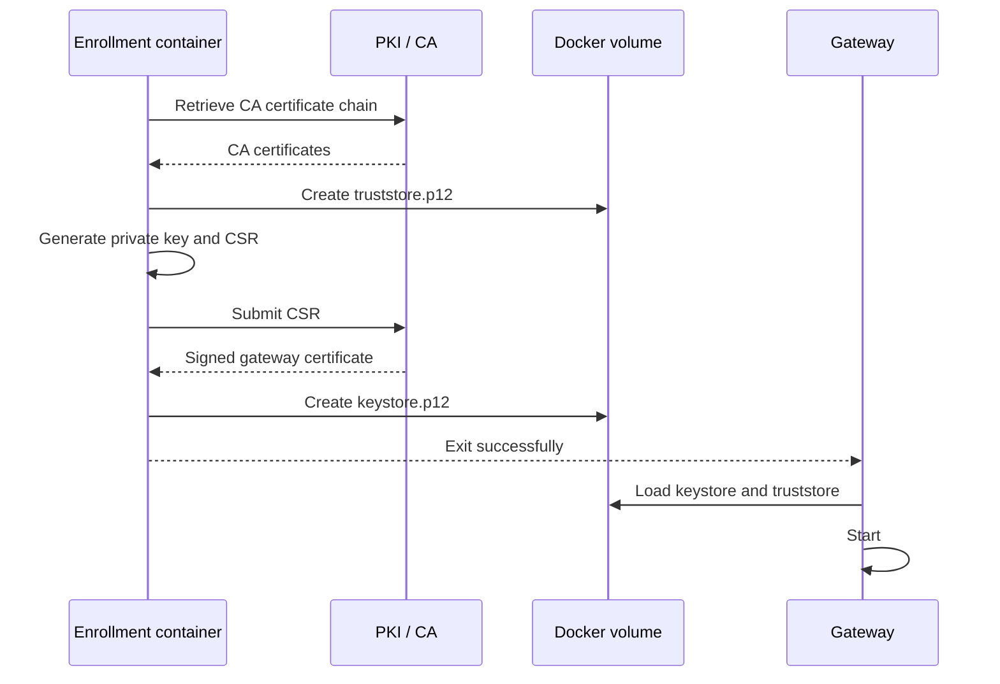

# IDMEFv2 IS Gateway

IDMEFv2 IS Gateway is a Docker Compose deployment package for securely transferring IDMEFv2 alert messages between security domains.

It provides two independently deployable gateway roles:

- **Gateway Sender** receives IDMEFv2 JSON alerts, applies the configured Information Sharing Agreement (ISA), and forwards the processed alert to a remote receiver.
- **Gateway Receiver** accepts incoming alerts over HTTPS with mutual TLS (mTLS), applies receiver-side ISA processing, and forwards accepted messages to Kafka through Kafka REST Proxy.

Each deployment contains an **enrollment** container. Enrollment retrieves the Certificate Authority (CA) chain, generates a private key and Certificate Signing Request (CSR), submits the CSR to the PKI, and stores the resulting truststore and keystore in a Docker volume. The relevant gateway starts only after enrollment completes successfully.

The receiver deployment also includes Kafka, ZooKeeper, Kafka REST Proxy, and Kowl to store and inspect processed messages.

## license

This deployment project is based on the SAFE4SOC Gateway Sender and Receiver implementation by [Fraunhofer-AISEC](https://github.com/Fraunhofer-AISEC/safe4soc-gateway)

## Architecture



## Certificate enrollment



## Repository layout

```text
.
├── README.md
├── SAFE4SOC.postman_collection.json
├── docker-compose-receiver.yml
├── docker-compose-sender.yml
├── enrollment/
│   ├── Dockerfile
│   ├── README.md
│   ├── entrypoint.sh
│   └── scripts/
│       ├── script_create_csr.sh
│       ├── script_send_csr.sh
│       ├── script_store_ca_truststore.sh
│       └── script_store_client_keystore.sh
├── gateway/
│   ├── Dockerfile
│   ├── entrypoint.sh
│   └── is-gateway/
│       ├── application.properties
│       └── s4sgateway
└── test_idmefv2.json
```

## Prerequisites

- Docker Engine
- Docker Compose v2
- Network access from both enrollment containers to the configured PKI endpoint
- A PKI process that approves submitted Certificate Signing Requests
- A reachable receiver hostname for the sender deployment
- The supplied `test_idmefv2.json` file for local testing

## Before deployment

Review the following values before starting either stack:

- `PKI_DOMAIN`: PKI endpoint used for CA retrieval and certificate enrollment.
- `GATEWAY_DOMAIN`: DNS name or gateway identifier placed in the CSR.
- `GATEWAY_ORGANIZATION`: Organization identifier used during enrollment and ISA configuration.
- `KEY_STORE_PASSWORD`: Password for the PKCS#12 gateway keystore.
- `TRUST_STORE_PASSWORD`: Password for the PKCS#12 CA truststore.
- `GATEWAY_RECEIVER_URL`: HTTPS URL of the remote receiver gateway.
- `KAFKA_TOPIC`: Kafka topic used by the receiver.

Do not use the default password values in a production deployment. Store production secrets in an environment-specific `.env` file, Docker secrets, or an external secret-management system.

## Environment configuration

Create a `.env` file beside each Compose file. Do not commit it if it contains production credentials.

### Receiver `.env`

```dotenv
PKI_DOMAIN=pki.safe4soc.cosypoc.fr

GATEWAY_DOMAIN=gateway-receiver
GATEWAY_ORGANIZATION=S4S

KEY_STORE_PASSWORD=change-this-keystore-password
TRUST_STORE_PASSWORD=change-this-truststore-password

KAFKA_TOPIC=my_processed
```

### Sender `.env`

For a sender and receiver running on different hosts, set `GATEWAY_RECEIVER_URL` to a resolvable receiver DNS name.

```dotenv
PKI_DOMAIN=pki.safe4soc.cosypoc.fr

GATEWAY_DOMAIN=gateway-sender
GATEWAY_ORGANIZATION=S4S

KEY_STORE_PASSWORD=change-this-keystore-password
TRUST_STORE_PASSWORD=change-this-truststore-password

GATEWAY_RECEIVER_URL=https://receiver.example.org:10081
```

The receiver certificate must be valid for the hostname used in `GATEWAY_RECEIVER_URL`.

## Deploy the receiver

Deploy the receiver stack before deploying the sender.

```bash
docker compose -f docker-compose-receiver.yml up -d
```

Follow the enrollment logs:

```bash
docker compose -f docker-compose-receiver.yml logs -f enrollment
```

Enrollment is complete when the container exits successfully:

```bash
docker compose -f docker-compose-receiver.yml ps
```

Check receiver startup logs:

```bash
docker compose -f docker-compose-receiver.yml logs -f gateway-receiver
```

The receiver is published on:

```text
https://<receiver-host>:10081
```

The receiver requires a valid client certificate because `SSL_MTLS_SETTING` is configured as `need`.

## Deploy the sender

After receiver enrollment and startup are complete, deploy the sender stack:

```bash
docker compose -f docker-compose-sender.yml up -d
```

Follow sender enrollment:

```bash
docker compose -f docker-compose-sender.yml logs -f enrollment
```

Check sender startup logs:

```bash
docker compose -f docker-compose-sender.yml logs -f gateway-sender
```

The sender receives alerts on host port `10080`:

```text
http://localhost:10080
```

The sender forwards alerts to the receiver URL configured by `GATEWAY_RECEIVER_URL`.

## Send a test alert

Submit the supplied test alert to the sender:

```bash
curl -X POST -sS -v \
  http://localhost:10080 \
  -H "Content-Type: application/json" \
  --data @./test_idmefv2.json
```

A successful request should return an HTTP success response from the downstream Kafka REST path.

## Verify message processing

Inspect the sender processing logs:

```bash
docker compose -f docker-compose-sender.yml logs -f gateway-sender
```

Inspect the receiver processing logs:

```bash
docker compose -f docker-compose-receiver.yml logs -f gateway-receiver
```

Inspect Kafka REST Proxy logs:

```bash
docker compose -f docker-compose-receiver.yml logs -f rest-proxy
```

Inspect Kafka logs:

```bash
docker compose -f docker-compose-receiver.yml logs -f kafka
```

Kowl is started with an automatically assigned host port. Find the mapped port with:

```bash
docker compose -f docker-compose-receiver.yml port kowl 8080
```

Open the displayed URL in a browser, then inspect the topic configured by `KAFKA_TOPIC`.

## ISA filtering and enrichment

The sender uses `ISACONFIG` to describe the Information Sharing Agreement. It includes metadata about the intended use of data and instructions for filtering and enrichment.

Example:

```json
{
  "provider_reason": "compliance",
  "intended_use": "alert_gathering",
  "data_usage_policies": {
    "use_until": "2024-12-12",
    "use_after": "2024-09-12",
    "share_further": false
  },
  "data_sender_SIEM_brand": "Example Company A",
  "data_sender_SIEM_version": "Version 0.1",
  "IDMEFv2_attributes": {
    "attributes_to_transmit": [],
    "attributes_to_neglect": [],
    "attributes_to_anonymize": [],
    "attributes_to_pseudonemize": []
  },
  "sending_mode": "",
  "encryption_requirements": [],
  "authentication_requirements": [],
  "connection_requirements": [],
  "filterConfig": {
    "CreateTime": "",
    "StartTime": "",
    "Cause": "",
    "OrganisationName": "S4S"
  },
  "enrichmentConfig": {
    "CreateTime": "",
    "StartTime": ""
  }
}
```

### Filtering

`filterConfig` identifies IDMEFv2 attributes whose contents should be cleared during processing.

For example, this configuration targets the `Cause` field:

```json
{
  "filterConfig": {
    "Cause": ""
  }
}
```

Use nested JSON objects to target nested fields. Review policy requirements carefully before changing filtering behavior.

### Enrichment

`enrichmentConfig` identifies fields that the gateway can enrich. Timestamp enrichment is included for `CreateTime` and `StartTime`.

```json
{
  "enrichmentConfig": {
    "CreateTime": "",
    "StartTime": ""
  }
}
```

Enrichment behavior depends on functionality implemented in the gateway application.

## Certificate enrollment behavior

The enrollment container performs the following tasks:

1. Retrieves CA certificates from `PKI_DOMAIN`.
2. Stores the CA chain in a PKCS#12 truststore.
3. Generates a local private key.
4. Creates a Certificate Signing Request for `GATEWAY_DOMAIN`.
5. Sends the CSR to the PKI enrollment endpoint.
6. Repeats certificate retrieval according to `REPEATS` and `SECONDS` while approval is pending.
7. Stores the signed certificate and private key in a PKCS#12 keystore.
8. Exits successfully so the gateway service can start.

Enrollment may remain pending if the PKI requires manual CSR approval. In that case, approve the request in the PKI and restart or rerun the enrollment service.

## TLS and mTLS

The receiver is configured to require mutual TLS:

```yaml
SSL_MTLS_SETTING: "need"
SSL_INBOUND_ACTIVATED: "true"
SSL_OUTBOUND_ACTIVATED: "false"
```

This means:

- The receiver presents its server certificate to the sender.
- The sender validates the receiver certificate against its truststore.
- The sender presents a client certificate.
- The receiver validates the sender certificate against its truststore.
- A sender without a trusted client certificate is rejected.

The sender Compose configuration should use an HTTPS receiver URL:

```yaml
GATEWAY_RECEIVER_URL: "https://receiver.example.org:10081"
```

For separate Docker hosts, do not rely on:

```yaml
extra_hosts:
  - "gateway-receiver:host-gateway"
```

That mapping is suitable only when the receiver is exposed through the Docker host. For production or cross-host communication, use a proper DNS hostname and configure `GATEWAY_RECEIVER_URL` accordingly.

## Troubleshooting

### Enrollment does not complete

Inspect enrollment logs:

```bash
docker compose -f docker-compose-sender.yml logs enrollment
```

```bash
docker compose -f docker-compose-receiver.yml logs enrollment
```

Check:

- `PKI_DOMAIN` is reachable from the container.
- The PKI CA certificate endpoint is available.
- The CSR has been approved if approval is manual.
- `GATEWAY_DOMAIN` has no trailing spaces.
- Keystore and truststore passwords are consistent between enrollment and gateway services.
- The named volume is mounted correctly.

### Sender cannot connect to receiver

Check the configured URL:

```bash
docker compose -f docker-compose-sender.yml exec gateway-sender \
  printenv GATEWAY_RECEIVER_URL
```

Check:

- The receiver is running and host port `10081` is reachable.
- DNS resolves the hostname in `GATEWAY_RECEIVER_URL`.
- The receiver certificate is valid for that hostname.
- Sender and receiver truststores contain the required CA chain.
- The sender has a valid client certificate.
- The receiver requires mTLS and trusts the sender certificate chain.

### TLS handshake failures

Inspect gateway logs:

```bash
docker compose -f docker-compose-sender.yml logs gateway-sender
```

```bash
docker compose -f docker-compose-receiver.yml logs gateway-receiver
```

Typical causes include:

- A mismatched hostname in `GATEWAY_RECEIVER_URL`.
- A missing or expired certificate.
- Different CA chains at sender and receiver.
- Incorrect keystore or truststore password.
- A certificate that lacks the expected DNS name.
- Sender certificate not trusted by the receiver.

### Receiver starts before Kafka is ready

The receiver Compose file waits for the REST Proxy health check. If startup still fails, inspect the dependent services:

```bash
docker compose -f docker-compose-receiver.yml ps
docker compose -f docker-compose-receiver.yml logs kafka
docker compose -f docker-compose-receiver.yml logs rest-proxy
```

### No message appears in Kafka

Check the full chain:

```bash
docker compose -f docker-compose-sender.yml logs gateway-sender
docker compose -f docker-compose-receiver.yml logs gateway-receiver
docker compose -f docker-compose-receiver.yml logs rest-proxy
docker compose -f docker-compose-receiver.yml logs kafka
```

Confirm that:

- The request was sent to the sender endpoint.
- The sender successfully forwarded the message to the receiver.
- Receiver-side TLS/mTLS validation succeeded.
- The receiver can reach `rest-proxy:8082`.
- The configured `KAFKA_TOPIC` is correct.
- Kafka and REST Proxy are healthy.

## Stop the deployment

Stop the sender:

```bash
docker compose -f docker-compose-sender.yml down
```

Stop the receiver:

```bash
docker compose -f docker-compose-receiver.yml down
```

To remove generated certificate material, remove the corresponding named volumes. This forces enrollment to create or retrieve material again on the next deployment.

```bash
docker compose -f docker-compose-sender.yml down -v
docker compose -f docker-compose-receiver.yml down -v
```

Use this carefully: deleting volumes removes the local keystore and truststore.
